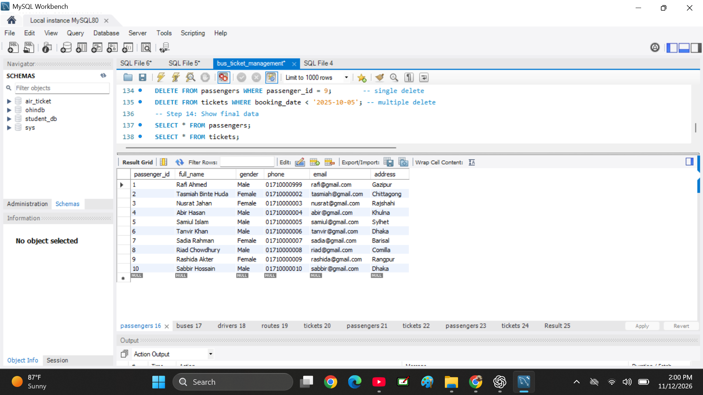
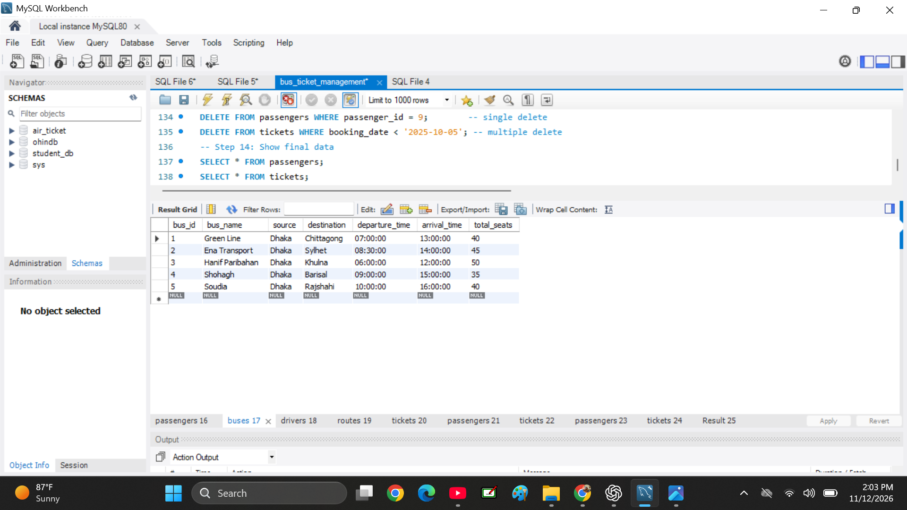
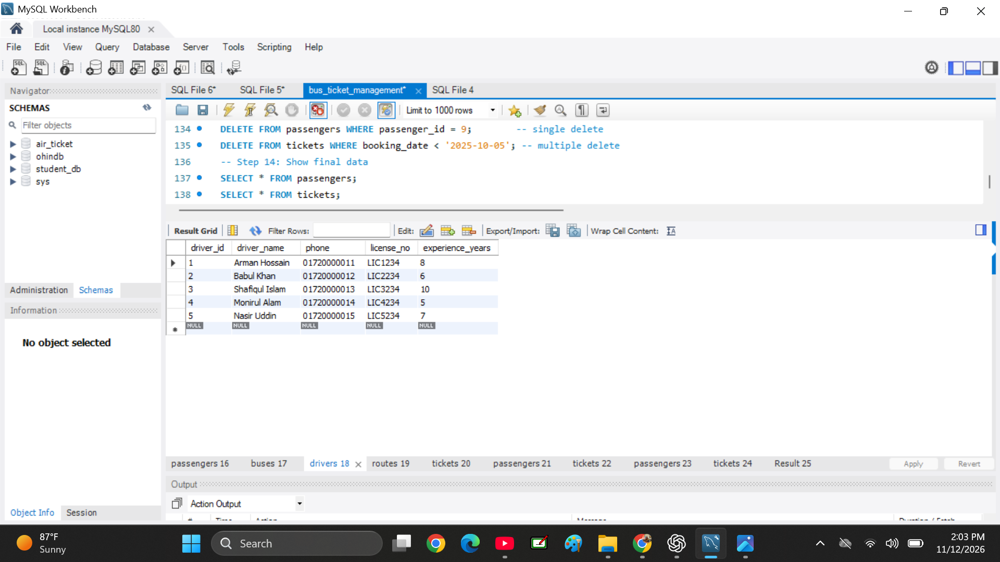
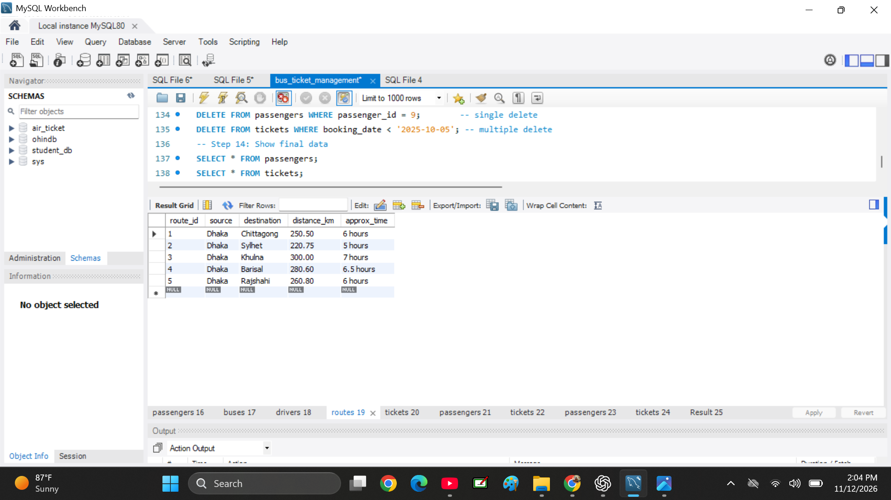
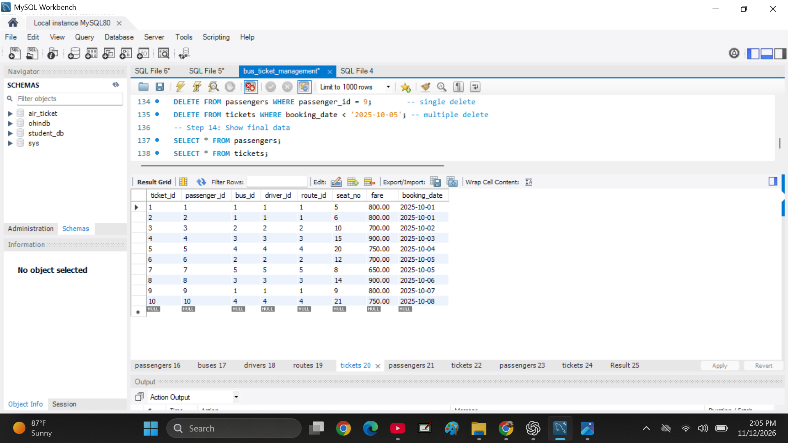

#  Bus Ticket Management System

##  Project Overview
This project is a Bus Ticket Management System developed using MySQL. It is designed to manage bus information, drivers, passengers, routes, and ticket bookings through SQL queries.

##  Project Objectives
- Organize bus and driver information.
- Manage passenger details.
- Store route information.
- Manage ticket booking records.
- Retrieve and manage data using SQL queries.

##  Technologies Used
- MySQL
- MySQL Workbench
- SQL

##  Database Structure

The project contains five main tables:

1. **Buses** – Stores bus information.
2. **Drivers** – Stores driver details.
3. **Passengers** – Stores passenger information.
4. **Routes** – Stores route information.
5. **Tickets** – Stores ticket booking details.

##  SQL Concepts Used
- CREATE DATABASE
- CREATE TABLE
- INSERT INTO
- SELECT
- WHERE
- UPDATE
- DELETE
- Data Retrieval
- Filtering Records

##  How to Use
1. Download the `bus_ticket_management.sql` file.
2. Open MySQL Workbench.
3. Open the downloaded SQL file.
4. Connect to your MySQL server.
5. Execute the SQL script.
6. Explore the database tables and queries.

##  Project File
- `bus_ticket_management.sql`

##  Author
GitHub: tasmia binte huda18-gif

---

 Thank you for visiting my project!
 ## Database Screenshots

### 1. Passengers Table

### 2. Buses Table

### 3. Drivers Table

### 4. Routes Table

### 5. Tickets Table

